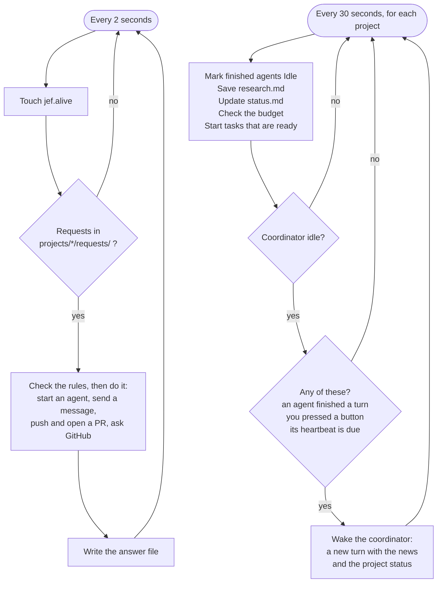
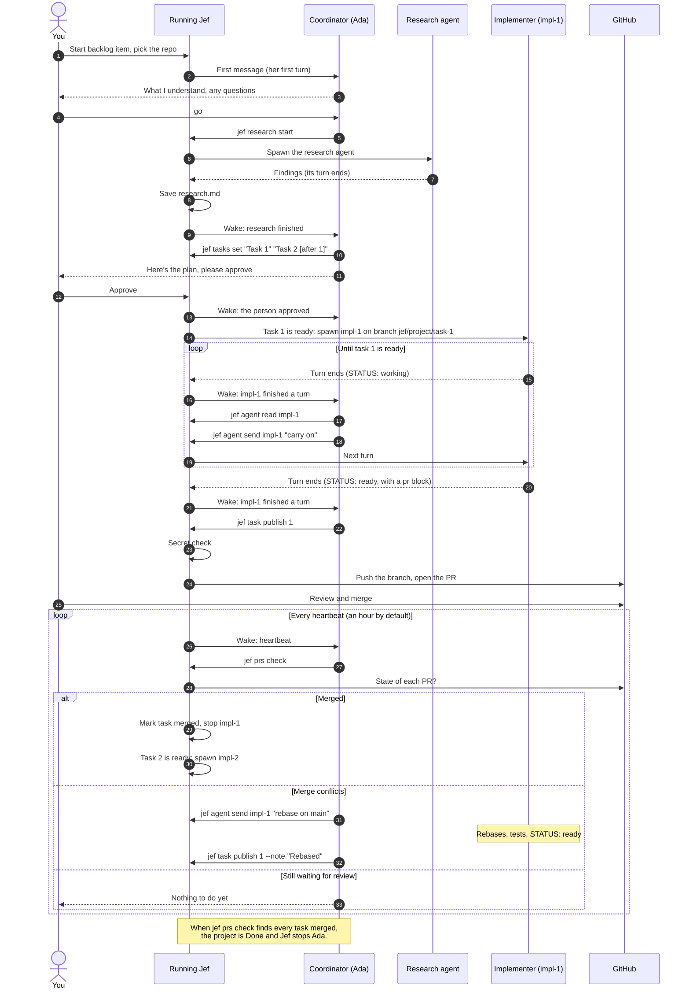

# Jef

**A user-friendly software factory.**

You tell Jef what you want built. Jef keeps a backlog, and when you say go, it hands the work to a team of AI agents. Each piece of work comes back as a pull request on GitHub, and you decide what gets merged.

> Status: early development. Jef is building itself first. The whole loop works: backlog → coordinator → research → tasks → implementers → PRs you merge.

## Running Jef

### Install (once)

Jef runs its agents in [Claude Code](https://code.claude.com/docs/en/quickstart), so install that first, run `claude` once and sign in. Then:

```
git clone git@github.com:gregyu219/Jef.git
cd Jef
python3 -m venv .venv
.venv/bin/pip install -e '.[dev]'
mkdir -p ~/.local/bin
ln -s "$PWD/.venv/bin/jef" ~/.local/bin/jef
brew install tmux
```

The `ln -s` line puts the `jef` command on your PATH, so you can type `jef` from any folder. (If `jef` isn't found afterwards, add `~/.local/bin` to your PATH.) Because Jef is installed in editable mode, code changes take effect without reinstalling.

### Commands

| Command | What it does |
| --- | --- |
| `jef start` | Runs Jef in the background and opens your browser. Keeps going after you close the terminal. |
| `jef status` | Shows whether Jef is running, and its address |
| `jef attach` | Opens Jef's background session so you can watch it. Press **Ctrl+B**, then **D**, to leave it running. |
| `jef stop` | Stops Jef |
| `jef run` | Runs Jef in this terminal instead. **Ctrl+C** stops it. Plain `jef` does the same. |

When it starts, Jef sends Claude Code one tiny message (on the smallest model) to make sure agents will be able to run. If that fails, Jef still starts: the home page shows your backlog and projects with a message at the top saying what's wrong, and no agent runs. Fix it (install Claude Code, or run `claude` and sign in), then press **Check again** in Settings. Agents can run straight away, with no restart.

Jef's page is at http://127.0.0.1:8765. It only listens on your own computer; nothing else on your network can reach it.

Options for `start` and `run`: `--port 9000` to use another port, `--no-browser` to skip opening the browser. Set `JEF_HOME=/some/folder` to use a different workspace than `~/.jef`.

### Running all the time

Jef wakes each coordinator on its heartbeat (every hour by default), so Jef needs to stay running. `jef start` handles that: it runs Jef inside a background [tmux](https://github.com/tmux/tmux) session named `jef`, wrapped in `caffeinate -is` so your Mac doesn't fall asleep while it's plugged in.

Things it can't help with:

- **Sleep:** if your Mac sleeps, Jef pauses until it wakes. Closing a laptop lid puts it to sleep unless it's plugged in with an external display, and `caffeinate` doesn't keep a Mac on battery awake. A fetch or push that was mid-way when it slept gives up within about a minute of waking (Jef gives git an SSH keepalive, unless you've set your own `GIT_SSH_COMMAND` or `core.sshCommand`), and the coordinator can try again. Git and GitHub calls run without holding up the rest of Jef, so one slow call doesn't stop the heartbeat or other projects.
- **Restarts:** after a reboot, run `jef start` again.

### Using Jef from Telegram

1. In Telegram, message @BotFather, send `/newbot` and follow its steps. It gives you a token.
2. In Jef, open Settings, paste the token under Telegram and press Save. Jef checks it with Telegram, then shows a pairing code.
3. Send the bot `/start <code>` from your own account (or use the link Settings shows). That chat becomes the only one the bot answers. Send `/help` to see what it can do.

Anything you type that isn't a command goes to Jef's front desk, the same chat as on the home page, and Jef's answer is sent back to you when it's ready. `/reset` starts that chat over. `/add <feature>` adds an item to the backlog; start it from the home page. `/status` and `/backlog` show how things stand without any AI call.

To talk to a project's coordinator, send `/to <name>` (like `/to Radia`). From then on your messages go to that coordinator, and its answers come back to you, until you send `/to jef`. `/to Radia <message>` sends just one message. `/approve`, `/wake` and `/retry` do what the project page's buttons do: approve the proposed tasks, ask the coordinator to check now, and try again after a problem. Add the coordinator's name, or leave it out to use the one you picked with `/to`.

Jef asks Telegram for new messages itself (long polling), so nothing on your computer is opened to the internet, and the bot only answers while Jef is running. The token is kept in a file only you can read, outside `~/.jef` so no agent can read it: `~/Library/Application Support/jef/telegram.json` on a Mac. Set `JEF_SECRETS` to keep it somewhere else. Settings never shows the token again; **Forget this bot** deletes it. Telegram messages aren't end-to-end encrypted, so project details you see there pass through Telegram's servers.

## How it works

Jef has four levels. Each one hands work to the level below it and keeps track of its own part.

| Level | You talk to it about | It spins up | It keeps track of |
| --- | --- | --- | --- |
| **Jef** (the main UI) | Features you want, and when to start them | One coordinator per project, only after you confirm | Your backlog, plus each project's coordinator, GitHub repo and progress |
| **Project coordinator** | Requirements, and PRs that miss the point | One research agent per project, then one implementation agent per task, through its own `jef` commands | `goal.md`, `tasks.md`, each task's status, its implementers and their PRs |
| **Research agent** | Nothing directly; it reports to its coordinator | Nobody | The project's findings and proposed approach |
| **Implementation agent** | Nothing directly; it reports to its coordinator | Nobody | Its branch, its code changes and its PR |

### From idea to merged PR

1. **Tell Jef what you want.** Jef adds it to your backlog as *Waiting*. Nothing starts until you confirm, because every running project spends tokens.
2. **Confirm and connect GitHub.** Jef asks which GitHub repo the code goes to and which account commits it, then creates a named project coordinator.
3. **Research.** When you say go, the coordinator starts one research agent, which writes `research.md`. The coordinator turns that into `tasks.md` for you to approve. If you haven't approved it after a whole heartbeat, the coordinator may approve or revise it. You can turn that off per project. If you turned on *Auto approve* for the backlog item (its toggle is in the home page's backlog table, and works until the list is approved), Jef approves the list itself as soon as the coordinator has posted it.
4. **Build.** Each task gets one implementation agent. The coordinator plans tasks in waves, split by the files they touch, so as many as possible can be built side by side, up to the project's *Implementers at once* setting (1 by default). A task that needs another one's code says so in its title, like `[after 1]`, and the task table shows it in its *After* column. Jef starts every task with nothing left to wait for by itself, up to the limit, as soon as there's a free slot or the tasks it's after have merged. The coordinator only starts one itself to stack it on an unmerged task's branch (`--on`), or when Jef can't. It reads each implementer's replies, nudges it on its heartbeat, has Jef open the PR when it's ready, and checks the PR on GitHub. After a merge it revises the tasks that are left if what merged changed the picture. If a PR gets merge conflicts, it has the implementer rebase, and Jef pushes the fix to the same PR. The project page shows who started each agent.
5. **Review.** You review each PR on GitHub and merge it. If one misses the point, chat with its coordinator by name and it will revise the work or start over.

**Deleting.** Every backlog item and every project has a **Delete** button, whatever state it's in, and asks you to confirm first. Deleting a project, or a backlog item that has one, stops its agents, deletes its local folder (`~/.jef/projects/<slug>/`: the clone, worktrees, chats, tasks and cost history) and removes its backlog row. Its branches and PRs on GitHub stay.

### Task statuses

Every task in a project's status table is in one of five states:

**Not started → Research → Implementation → Pending review → Merged**

*Research* only appears when the coordinator sends extra research for a single task. Most tasks go straight from Not started to Implementation.

### Who does what

**The coordinator runs its project; Jef only keeps time and keeps the rules.**

A coordinator acts with its own `jef` commands, grouped by what they act on. They only work inside a coordinator's turn (Jef sets `JEF_PROJECT` and `JEF_AGENT` for coordinators and nobody else, and only coordinators may run `jef`):

| Command | What it does |
| --- | --- |
| `jef overview` | The project at a glance (reads the files) |
| `jef agent read impl-2` | An agent's latest reply (reads the chat) |
| `jef research start ["brief"]` | Starts the research agent |
| `jef tasks set "Task" "Task" …` | Sets the task list. End a title with `[after 1, 2]` if the task needs tasks 1 and 2 merged first; a task can only come after earlier ones. While building, it replaces only the tasks that haven't started |
| `jef tasks approve` | Approves the list, only after it has waited a heartbeat for you and only if that's allowed for the project |
| `jef task start N` | Starts task N's implementer by hand (Jef usually starts ready tasks itself), if the project has fewer tasks being built than it builds at once (a task whose PR is open doesn't count). With `--on M`, it builds on task M's branch instead of `main`, once M's PR is open |
| `jef agent send impl-2 "…"` | Messages one of its own agents |
| `jef task publish N [--note …]` | Jef checks the commits for secrets, pushes the branch and opens the PR, or updates the open one (with the note as a comment) |
| `jef prs check` | Asks GitHub about every PR: merged (recorded, implementer stopped), conflicts, closed |
| `jef wait "…"` | Shows you on the project page that it's waiting for you |
| `jef agent stop impl-2` | Stops one of its own agents |

The reading commands work on their own. The others drop a request in the project's `requests/` folder; the running Jef carries it out within a few seconds and prints the answer. So Jef is the only thing that writes the project's files, starts agents and pushes code, and its rules hold whatever a coordinator asks: no more tasks at once than the project allows, only its own agents, no secrets pushed, never `main`, never a merge.

### Heartbeats

A coordinator can't wake itself: each agent is a Claude Code session that only runs while it answers a message. So Jef keeps time. It wakes a coordinator:

- **on its heartbeat**, once per interval (an hour by default; change it on the project page), while it's planning, waiting for approval (if it may approve) or building, and nothing is waiting for you,
- **straight away when one of its agents finishes a turn**, so it can read the reply and act,
- when you press **Approve**, **Start research**, **Try again** or **Ask the coordinator to check now**,
- **when Jef auto-approves the task list**: with *Auto approve* on, the half-minute check approves the list once the coordinator has posted it and finished its turn, then wakes it to start building.

Each wake-up says what changed and includes the project's status. On its heartbeat the coordinator nudges implementers that are still working, and runs `jef prs check` to check merges and conflicts. It doesn't start tasks: Jef does that by itself (see *Jef's timer* below). To get ahead, the coordinator may stack a task that needs another one's code on that task's branch (`jef task start N --on M`) once its PR is open. Heartbeats cost a coordinator turn each, so don't set the interval too short.

Besides that, Jef only reads files: every half minute it saves finished research as `research.md` and updates each project's `status.md`. That costs nothing. **Check status now** on the project page does the same straight away.

To see every project at once, press **Read status** above the Projects table on the home page. It rewrites each project's `status.md` from Jef's own files and shows each project's stage and its coordinator's state. It makes no AI or GitHub calls. You can also read one project's file at `/projects/<slug>/status`, or on its page under Status file.

By default tasks are built **one at a time**. Only tasks being built count: once a task's PR is open, Jef starts the next ready one without waiting for you to merge. Implementers start from the latest `main`, except a task that needs an unmerged task's code: it's **stacked**, built on that task's branch (`jef task start N --on M`). Its PR still targets `main` and says "Builds on #M … Merge that first"; once #M merges, it shows only its own changes. So merge stacked PRs in order. If #M changes in review, the coordinator has the later task rebase onto it. To build faster, raise **Implementers at once** on the project page (up to 5); the coordinator's plan suggests a number, the size of its largest wave. Jef then starts every task with nothing left to wait for side by side. More at once means faster progress, but also faster spending and more merge conflicts. Each implementer works in its own checkout (a git worktree) on its own branch, `jef/<project>/task-<n>`.

### The whole loop

Three kinds of program take part. **You** use Jef's web page. **The running Jef** (`jef start`) is the only thing that launches agents, writes the project's files and pushes code. **Agents** (the coordinator, the research agent, implementers) are Claude Code sessions that only run while they answer a message.

**Jef's timer.** This runs inside the running Jef. It never calls Claude to decide anything. A turn only starts when Jef wakes the coordinator, or when the coordinator asks for one. The one thing it starts by itself is a task that's ready: while building, every half minute, it starts each task whose *After* tasks have all merged, in order, up to *Implementers at once*, and tells the coordinator. It doesn't while the project has a problem or the coordinator is waiting for you. Lists set before Jef knew about *After* are left to the coordinator: `jef overview` shows `Jef starts ready tasks: yes` when Jef handles them.



**One project, start to finish.** Every arrow into an agent is a message that starts one of its turns. Every `jef …` command the coordinator runs is a request that Jef answers within a couple of seconds.



If an implementer is stuck, or Ada needs a decision, she asks you and runs `jef wait "…"`. The project page then shows what she's waiting for, and heartbeats (and Jef starting ready tasks) pause until she starts a task or you press **Try again**.

### How agents hand work back

Research and implementation agents only reply in text, to their coordinator:

| Who | Writes | What happens |
| --- | --- | --- |
| Research agent | Its whole final reply | Jef saves it as `research.md` and wakes the coordinator |
| Implementer | `STATUS: working` or `STATUS: stuck <reason>` | The coordinator reads it; it nudges, answers, or asks you |
| Implementer | A fenced `pr` block (title and description), then `STATUS: ready` | The coordinator runs `jef task publish`, and Jef checks for secrets, pushes the branch and opens the PR (or updates the open one) |

The skills in `skills/` tell each agent how to work. Each agent's skill is sent with every turn.

### Agents are chats

Like [KiroCrew](https://github.com/kirodotdev/KiroCrew), Jef doesn't call the model itself. It drives Claude Code in headless mode (`claude -p`), and Claude Code signs in however you set it up: your Claude login or your own API key. Jef never sees or stores a key.

Every agent is a named Claude Code session with its own conversation:

- **Spawning** an agent starts a new session with its first message.
- **Messaging** it later (a heartbeat nudge, a small fix) continues the same session, so it remembers everything so far.
- **Stopping** an agent also stops every agent it spawned, so stopping a coordinator stops its workers.

Nobody is around to answer permission prompts, so each role gets a fixed list of what it may do, and anything else is refused. Only implementers can change files. Coordinators, research agents and the home-page Jef chat are refused file edits outright, so they can't, for example, rewrite a project's `goal.md`. **No agent can push, open a PR or merge**, whatever its role: implementers only commit, coordinators ask Jef, and Jef's own code does the rest.

### Chat with Jef

The home page has its own chat with Jef. Ask it how projects are going, or talk through an idea before you add it to the backlog. Your first message starts a session whose briefing lists every backlog item and every project, one line each, and Jef can read the workspace files for more. It's read-only: to add or start backlog items, use the page's buttons. Its usage isn't counted in any project's total. **Reset** starts Jef over: it ends the session, saves the old conversation, and starts a new session with a fresh briefing, so Jef greets you already knowing where things stand.

### Jef opens the PRs

When an implementer reports `STATUS: ready`, Jef:

1. checks it's on its own `jef/...` branch, with everything committed,
2. runs the **secret check**: it scans every line added in every commit on the branch (so a secret that a later commit deleted is still caught, since the push sends the whole history), the commit messages and the PR text for things shaped like secrets (Anthropic API keys, GitHub tokens, private keys). If it finds one, it doesn't push, and it tells the agent which file to fix. It never repeats the secret itself,
3. pushes the branch, only ever the agent's own `jef/...` branch, never `main`, and
4. opens the PR with your GitHub login, or updates the PR that's already open.

If something needs fixing, Jef tells the agent, up to three times, then marks it stuck for you. The secret check only knows common secret shapes, so it's a safety net, not a guarantee. Agents can also run code (to build and test), so these rules aren't a sandbox. Turn on GitHub branch protection for `main` as the final guard. Agents' Claude Code auto memory is switched off, so they keep their notes in Jef's project files, not in your personal memory.

### Usage and cost

Every finished agent turn ends with a summary from Claude Code that includes the tokens it used and an estimated cost. Jef adds these up straight from the chat logs (no separate ledger) and shows them per agent and per project on the project page, the agent page and the home page. The costs are Claude Code's estimates at API list prices: if you sign in with a Claude subscription you aren't billed per token, so read them as "what this would cost on the API". A turn that's stopped before it finishes writes no summary, so its usage isn't counted.

The home page also shows your Claude plan usage: how much of the 5-hour session and the weekly limit you've used, and when each resets. It's what Claude Code's `/usage` shows, read from the newest `rate_limit_event` in any agent's (or Jef chat's) log, so it costs nothing to look at. It's only as fresh as the last agent run, so Claude use outside Jef shows up after the next one. Sign-ins with an API key don't report plan limits. Below it is Jef's total estimated cost across all projects.

### Budgets

Each project can have a dollar budget, set under Usage on its project page (it's saved as a `- Budget: 20.00 USD` line in `goal.md`). Projects have no budget unless you set one. With a budget:

- Before starting any agent turn, Jef checks what's left. Once the estimated cost reaches the budget, the project pauses: no agent starts another turn, the heartbeat stops nudging, and messages to the coordinator are refused. A banner on the project page says so.
- Each turn is also started with Claude Code's `--max-budget-usd` set to what's left, so one long turn gets stopped partway instead of running far past the budget. This needs a recent Claude Code (v2.1.217 or later).
- Raise the budget (or clear it) and the project carries on by itself.

Spending can still go a little over: a turn's cost is only known once it's finished, and Claude Code stops a turn a bit after it reaches its cap.

### Models

Each level of a project runs on its own model: Sonnet for the coordinator, Opus for research and implementers. Change them under Models on the project page (they're saved as lines like `- Coordinator model: haiku` in `goal.md`). Pick `haiku`, `sonnet`, `opus`, `fable`, or `default` for Claude Code's own default. A change applies from each agent's next turn. That first turn on the new model re-reads its conversation without the prompt cache, so it costs a little more.

### Prompt caching

Claude Code caches the parts of a conversation that repeat from turn to turn (the skill, and files like `goal.md` and `research.md` the agent has already read), and cache reads cost about a tenth of normal input. With an API key the cache lasts only 5 minutes by default, and heartbeats are an hour apart, so Jef starts coordinator turns with `CLAUDE_CODE_PROMPT_CACHE_TTL=1h` to keep it from one heartbeat to the next (Claude Code v2.1.242 or later; on a Claude subscription it's already an hour). If you've set that variable yourself, Jef leaves it alone. The project page shows each agent's model and cache hit rate, and the project's hit rate and cost per turn, so you can see what it saves.

You're responsible for using Claude Code within [Anthropic's terms](https://www.anthropic.com/legal) for the account you sign in with.

## Where Jef keeps things

Everything lives in plain markdown in Jef's workspace, outside your code repos:

```text
~/.jef/
  backlog.md              everything you asked for
  projects/
    <project>/
      goal.md             what the project is for
      research.md         findings and approach
      tasks.md            every task and its status
      agents.md           every agent: role, who spawned it, status, session
      status.md           where the project is: its phase, the coordinator's state
                          and each task's stage. Jef writes it from the files above
                          on every heartbeat, with no AI call, so you can just read it
      chats/<agent>.jsonl each agent's full conversation
      research/           extra research for single tasks (rare)
      repo/               the coordinator's clone of the project's repo
      work/impl-<n>/      each implementer's own checkout
  jef/projects/home/      the home page's chat with Jef (agents.md, chats/jef.jsonl;
                          chats/jef-<time>.jsonl are earlier chats kept by Reset)
```

## Ground rules

- **Jef never merges.** A human always has the final say.
- **No agent pushes to `main`.** Every change arrives as a PR from its own branch.
- **Nothing starts without you.** Jef asks before turning a backlog item into a project.
- **Costs are estimates.** Usage and budgets use Claude Code's own cost estimates at API list prices.
- **Skills are yours.** The coordinator and each agent type follow a skill you write, in markdown.

## Tech

- Python
- Runs locally on your computer
- Local web UI in your browser
- Agents run in Claude Code, in headless mode

## Inspiration

The heartbeat-until-done approach comes from [KiroCrew](https://github.com/kirodotdev/KiroCrew), applied here specifically to building software.
